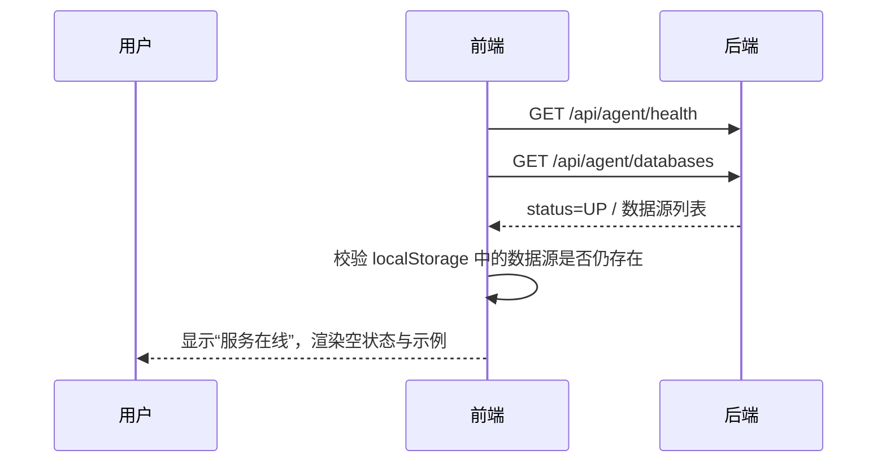
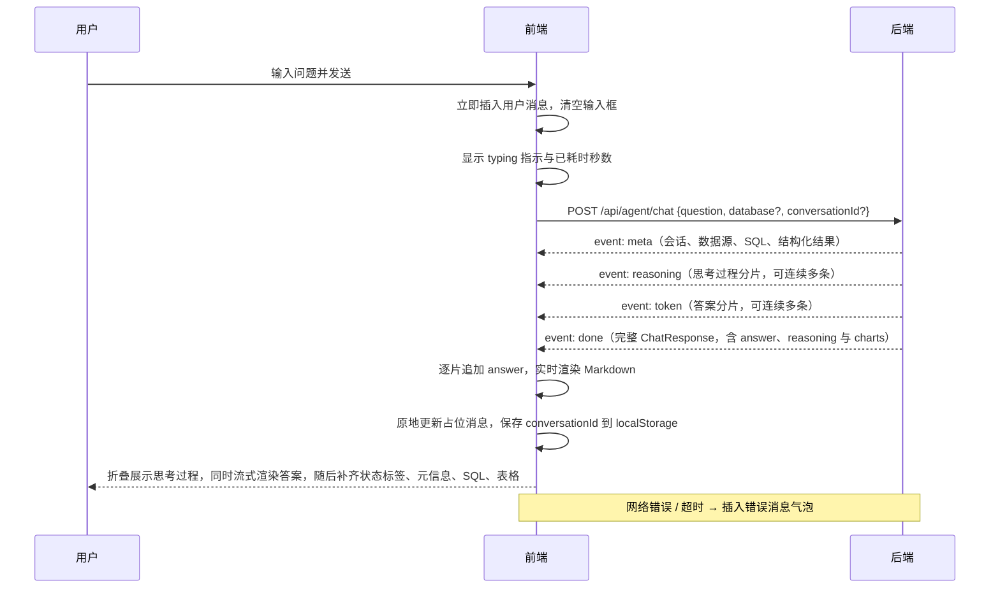

# RinBI Frontend

RinBI 数据问答助手的前端，基于 Vue 3 + Vite + Element Plus。用户登录后选择自己的数据源，用自然语言提问；页面通过 SSE 实时展示思考过程与答案，并在查询成功后渲染结果表格、SQL 和多个 ECharts 图表。历史会话保存在后端，可在侧栏恢复或删除。新用户可以提交注册申请，管理员在控制台审批账号，先统一配置数据源，再通过授权弹框勾选用户可访问的数据库。

## 技术栈

| 用途 | 技术 |
| --- | --- |
| 框架 | Vue 3.2（`<script setup>`） |
| 构建 | Vite 2.9 |
| UI | Element Plus 2.2 |
| Markdown | markdown-it 12 + DOMPurify 2.4 |
| 图表 | ECharts 5.4.3（按需引入，`ChartPanel` 懒加载） |
| 请求 | 原生 `fetch` + `ReadableStream` 解析 SSE |

## 快速开始

1. 启动后端，默认地址为 `http://localhost:8080`；
2. 安装依赖并启动开发服务器：

```powershell
npm ci
Copy-Item .env.example .env.local
npm run dev
```

浏览器访问 `http://localhost:5173`。开发服务器会把 `/api` 代理到 `VITE_PROXY_TARGET`，默认即后端 `8080` 端口。

首次打开会进入登录页，可使用后端初始化账号登录（默认 `admin / admin123`，可在后端 `RINBI_ADMIN_*` 环境变量中修改）。登录页可切换到「申请注册」，注册成功后账号处于待审批状态，需要管理员在「用户管理」中通过后才能登录。

## 环境变量

| 变量 | 默认值 | 说明 |
| --- | --- | --- |
| `VITE_API_BASE_URL` | 空 | 留空时请求同源 `/api` 并由 Vite 代理；前后端分域部署时填写后端完整地址 |
| `VITE_PROXY_TARGET` | `http://localhost:8080` | 仅开发服务器使用，`/api` 的代理目标 |

## 项目结构

```text
src/
├─ App.vue                    # 登录态、会话状态、SSE 消息流、历史面板、数据源切换
├─ main.js                    # 应用入口
├─ api/
│  ├─ http.js                 # API_BASE、请求封装、ApiError、401 统一处理
│  ├─ auth.js                 # 注册申请、登录、当前用户、退出
│  ├─ admin.js                # 用户分页/审批、数据源分页增删改查、用户授权
│  ├─ history.js              # 历史会话列表、详情、删除
│  └─ agent.js                # 健康检查、数据源、SSE 聊天、清空会话
├─ components/
│  ├─ LoginView.vue           # 登录 / 注册申请、表单校验与错误提示
│  ├─ AdminPanel.vue          # 管理员用户分页、数据源分页与用户授权控制台
│  ├─ ChatMessage.vue         # 单条回答、Markdown、图表与表格编排
│  ├─ ChartPanel.vue          # 多个 ChartSpec -> ECharts option
│  ├─ ChartCanvas.vue         # ECharts 实例生命周期与自适应
│  └─ QueryResultTable.vue    # 结果表格、分页与 SQL 追溯
├─ styles/                    # 基础样式、聊天布局、登录/历史、管理员控制台、组件与响应式
└─ utils/
   ├─ session.js              # localStorage token、请求头、401 事件
   ├─ format.js               # 时间、耗时、状态格式化
   └─ markdown.js             # Markdown 渲染、HTML 清洗、剥离 chart 代码块
```

## 登录、鉴权与历史会话

### 登录流程

1. 应用启动时从 `localStorage`（键 `rinbi.token`）读取 token；有 token 时调用 `GET /api/auth/me` 校验并加载工作区，无 token 或校验失败则展示 `LoginView`。
2. 登录调用 `POST /api/auth/login`，成功后把 token 写入 `localStorage`，并加载数据源与历史列表。
3. 登录页切换到「申请注册」时调用 `POST /api/auth/register`，提交用户名、密码、确认密码与可选显示名称；后端只创建待审批账号，不签发 token，前端提示等待管理员审批。
4. 所有 JSON 请求由 `src/api/http.js#request` 自动附带 `Authorization: Bearer <token>`；SSE 请求在 `src/api/agent.js` 中同样附带该请求头。
5. 任意请求返回 `401` 时，`handleUnauthorized()` 会清除 token 并触发 `rinbi:unauthorized` 事件；`App.vue` 监听后重置会话状态并回到登录页。返回 `403` 时仅在当前页面提示，不会清除登录态。
6. 退出登录调用 `POST /api/auth/logout`，无论后端是否成功都会清除本地 token。

> token 是不透明字符串，前端不解析其内容；服务端重启会导致 token 失效，此时下一次请求收到 `401` 并自动回到登录页。管理员禁用账号后，后端会立即吊销该用户 token，下一次请求同样回到登录页。

### 管理员控制台

当 `GET /api/auth/me` 返回的 `user.role === "ADMIN"` 时，顶部显示「用户管理」入口；普通用户不会渲染该入口，但真正的权限校验仍在后端 `AdminService` 中完成。

- **用户列表**：调用 `GET /api/admin/users?page=1&size=10`，后端按「待审批 → 正常 → 禁用」优先排序；支持按用户名/显示名称搜索、状态筛选和分页。
- **审批/拒绝**：对待审批用户调用 `POST /api/admin/users/{id}/approve` 或 `/disable`；通过后用户即可登录，拒绝会将其置为禁用状态。已禁用用户可通过「启用账号」重新审批。
- **数据源配置**：全局数据源通过 `GET /api/admin/datasources?page=1&size=10` 分页展示；新增/编辑走 `POST` / `PUT /api/admin/datasources`，删除走 `DELETE`。弹窗支持数据库 key、类型、JDBC URL、host/port/库名、账号密码、驱动、连接池、只读与启停等字段。
- **用户授权**：点击数据源的「授权用户」打开勾选弹框，加载 `GET /api/admin/datasources/{id}/users`，保存时以 `PUT` 提交最终 `userIds`。普通用户只能看到并查询已授权的数据源。
- **密码处理**：列表只显示 `passwordConfigured`，不返回密码；编辑时密码留空表示保留原密码，新密码由后端使用 AES-GCM 加密后落库。
- **会话失效**：管理员禁用账号后，该用户已登录的页面会在下一次请求收到 `401` 并自动退出。

### 历史会话

- 侧栏通过 `GET /api/history/conversations?limit=50` 加载最近会话，展示标题、数据源与更新时间；
- 点击会话调用 `GET /api/history/conversations/{id}`，把用户消息与助手 `response` 解析为 `ChatMessage` 所需的 `{ answer, status, reasoning }`，恢复 Markdown、表格、图表与 SQL，并设置当前 `conversationId` 以支持继续追问；
- 删除调用 `DELETE /api/history/conversations/{id}`；若删除的是当前会话，会同时重置聊天区；
- 页面加载时若存在上次的 `conversationId`，会静默尝试恢复；会话已不存在（`404`）则从列表移除并重置；
- 每轮问答完成后自动刷新历史列表，新会话出现在最上方。

## 多图表渲染

### 数据契约

后端在 `done` 事件返回完整 `ChatResponse`，其中 `charts` 只描述“怎么画”，不携带数据；数据统一来自同一响应的 `table`：

```json
{
  "table": {
    "columns": ["REGION", "CUSTOMER_COUNT"],
    "rows": [["华东", "4"], ["华北", "1"]]
  },
  "charts": [
    {
      "type": "bar",
      "title": "各地区客户数量",
      "xField": "REGION",
      "yFields": ["CUSTOMER_COUNT"],
      "unit": "个"
    },
    {
      "type": "pie",
      "title": "各地区客户数量占比",
      "xField": "REGION",
      "yFields": ["CUSTOMER_COUNT"],
      "unit": "个"
    }
  ]
}
```

- `type` 支持 `bar`、`line`、`pie`、`scatter`；
- `xField` / `yFields` 必须是 `table.columns` 中的列名，前端匹配时忽略大小写与首尾空格；
- 后端最多返回 4 个 `ChartSpec`。提示词通常要求模型给出 1–3 个互补视角（趋势、对比、占比），并避免重复类型的图表；
- 后端兼容多个 `chart` 代码块、单个代码块内的 JSON 数组以及 `{"charts":[...]}` 写法；每个图表独立校验，非法图表只丢弃自身，不影响文字答案与其他图表。

### 前端处理流程

1. `token` 事件到达时追加答案文本，`renderMarkdown()` 先剥离未完成或已完成的 `chart` 代码块，避免流式阶段闪现原始 JSON；
2. `done` 事件用完整响应覆盖消息，`ChatMessage.vue` 仅在 `charts` 非空时渲染 `ChartPanel`；
3. `ChartPanel.vue` 遍历 `charts`，逐个把 `ChartSpec` 转换为 ECharts option；类型不支持、`xField` 不存在或 `yFields` 全部无效时只跳过该图表；
4. `ChartCanvas.vue` 使用 `setOption(option, true)` 全量替换配置，并通过 `ResizeObserver` 跟随容器变化；组件卸载时 `dispose()`；
5. `ChartPanel` 通过 `defineAsyncComponent` 动态加载，回答不含图表时不会下载 ECharts chunk。

### 布局与响应式

- 图表容器使用 `grid-template-columns: repeat(auto-fit, minmax(340px, 1fr))`，卡片间距 `14px`；
- 宽屏最多并排两张卡片；奇数张图表时最后一张占满整行，避免孤立在半宽列；
- `≤ 640px` 固定为单列，图表高度降为 `250px`；
- 图表只取前 `200` 行绘制，空值保持 `null`，避免极端结果集拖慢浏览器。

### 安全与容错

- 图表配置完全由前端白名单字段生成，模型输出的 ECharts option、HTML、JavaScript 或 SVG 不会进入 DOM；
- Markdown 统一经过 DOMPurify 清洗；
- 后端图表解析失败或前端无法匹配 `xField` / `yFields` 时，只跳过对应图表，不影响文字答案、结果表格与 SQL 展示；
- 无有效图表时整个图表区域自动隐藏。

## SSE 事件

SSE 请求通过 `fetch` + `ReadableStream` 实现（而非 `EventSource`），因此可以附带 `Authorization` 请求头；非 2xx 响应会先读取 `ApiError`，`401` 时清理登录态。

| 事件 | 内容 | 前端处理 |
| --- | --- | --- |
| `meta` | 会话、数据源、状态、SQL、结果表格等元信息 | 更新消息元信息与表格 |
| `reasoning` | 思考过程分片 | 折叠面板内实时追加 |
| `token` | 答案分片 | 追加并实时渲染 Markdown |
| `done` | 完整 `ChatResponse`（含 `answer`、`reasoning`、`charts`） | 覆盖消息为最终结果 |
| `error` | 流内错误 `{ code, message, status }` | 转为消息流中的错误提示 |

## 构建与部署

```powershell
npm run build
npm run preview
```

构建产物输出到 `dist/`。部署时由静态服务器托管 `dist/`，并将 `/api` 反向代理到后端；若前后端分域部署，在构建时设置 `VITE_API_BASE_URL` 为后端地址，并确保：

- 后端 CORS 允许前端域名，且允许 `Authorization` 请求头（SSE 同样需要）；
- 反向代理不要缓存 SSE 响应（后端已发送 `Cache-Control: no-cache` 与 `X-Accel-Buffering: no`）；
- 登录态存放在 `localStorage`，XSS 可读取；生产环境应启用 CSP 并保持 Markdown/HTML 清洗。

登录、历史与问答接口的完整说明见后端 README 的「HTTP API」章节。

## 核心交互流程

### 首次加载



两个请求使用 `Promise.allSettled`，任一失败都不阻塞页面：页面顶部显示可关闭的警告，数据源列表为空时 Select 禁用。

### 提问



- `database` 为空字符串时不发送该字段，由后端自动选库。
- 首次请求不发送 `conversationId`，由后端创建并返回。
- 响应为 SSE：`meta` 先到，`reasoning` 与 `token` 都可连续多条，`done` 携带完整答案；答案以 token 分片增量下发，`done` 到达后以完整文本覆盖。
- 同一时间只允许一个请求：`sending` 为真时输入框与发送按钮禁用。
- 点击示例问题只填入输入框并聚焦，不自动发送，避免误触。

### 清空会话

1. 有消息或会话 ID 时才启用按钮；
2. `ElMessageBox.confirm` 二次确认；
3. 立即清空本地消息与 `conversationId`；
4. 若存在服务端 ID，调用 `DELETE /api/agent/conversations/{id}`；
5. 删除失败只提示“本地已清空，服务端清理失败”，不恢复旧消息。
