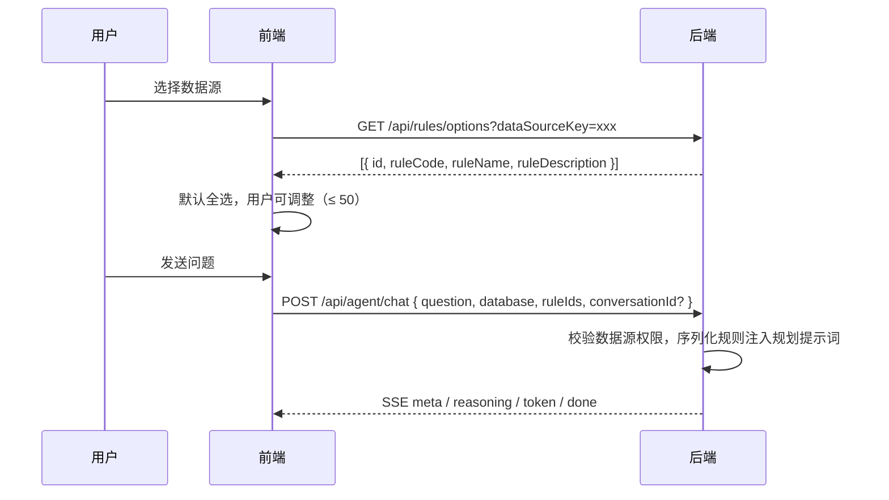
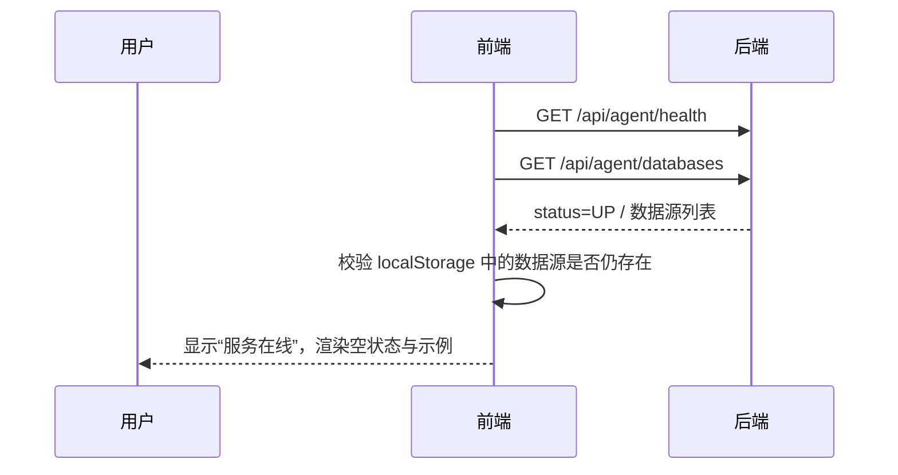
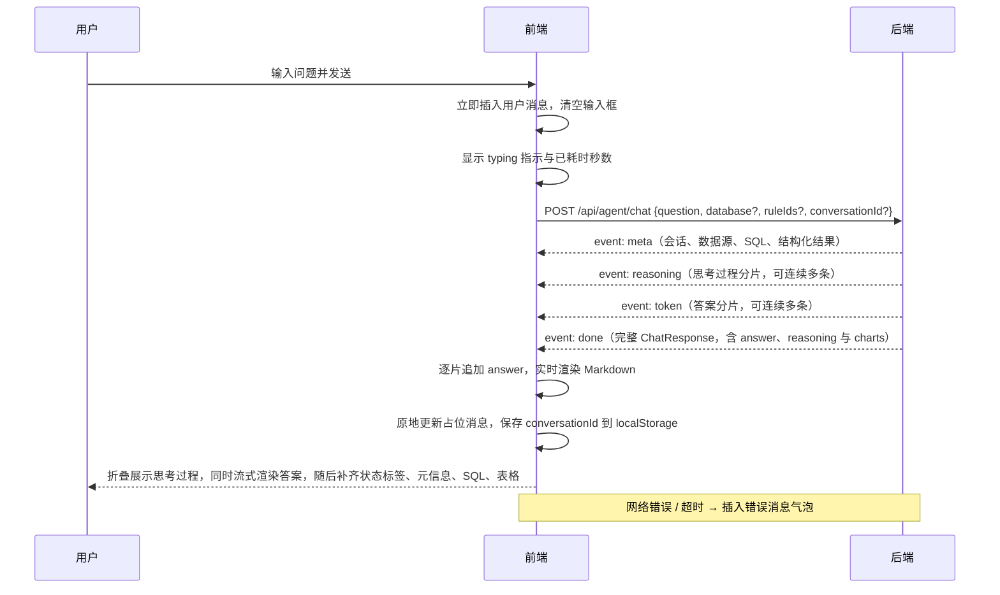

# RinBI Frontend

[中文](./README.md) | [English](./README.en.md)

RinBI 数据问答助手的前端，基于 Vue 3 + Vite + Element Plus。登录后可在页面顶部切换 **数据问答** 与 **智能报表** 两个功能：数据问答用自然语言提问，通过 SSE 实时展示思考过程与答案，并渲染结果表格、SQL 与多个 ECharts 图表；智能报表先上传 Excel 模板（模板保存在服务器，可再次下载），再描述需求生成报表，并可在同一会话里多轮要求模型调整报表内容，每轮输出新的 Excel 文件。两个功能的会话与历史彼此独立，均可在侧栏恢复或删除；登录用户还可以按数据源维护统计规则，在提问与报表时勾选需要遵循的业务口径。新用户可以提交注册申请，管理员在控制台审批账号，先统一配置数据源，再通过授权弹框勾选用户可访问的数据库。

## 技术栈

| 用途 | 技术 |
| --- | --- |
| 框架 | Vue 3.2（`<script setup>`） |
| 构建 | Vite 2.9 |
| UI | Element Plus 2.2 |
| Markdown | markdown-it 12 + DOMPurify 2.4 |
| 图表 | ECharts 5.4.3（按需引入，`ChartPanel` 懒加载） |
| 请求 | 原生 `fetch` + `ReadableStream` 解析 SSE |

## 快速开始

1. 启动后端，默认地址为 `http://localhost:8080`；
2. 安装依赖并启动开发服务器：

```powershell
npm ci
Copy-Item .env.example .env.local
npm run dev
```

浏览器访问 `http://localhost:5173`。开发服务器会把 `/api` 代理到 `VITE_PROXY_TARGET`，默认即后端 `8080` 端口。

首次打开会进入登录页，可使用后端初始化账号登录（默认 `admin / admin123`，可在后端 `RINBI_ADMIN_*` 环境变量中修改）。登录页可切换到「申请注册」，注册成功后账号处于待审批状态，需要管理员在「用户管理」中通过后才能登录。

## 环境变量

| 变量 | 默认值 | 说明 |
| --- | --- | --- |
| `VITE_API_BASE_URL` | 空 | 留空时请求同源 `/api` 并由 Vite 代理；前后端分域部署时填写后端完整地址 |
| `VITE_PROXY_TARGET` | `http://localhost:8080` | 仅开发服务器使用，`/api` 的代理目标 |

## 项目结构

```text
src/
├─ App.vue                    # 登录态、功能切换、会话状态、SSE 消息流、报表模板与历史面板
├─ main.js                    # 应用入口
├─ api/
│  ├─ http.js                 # API_BASE、请求封装、ApiError、401 统一处理
│  ├─ auth.js                 # 注册申请、登录、当前用户、退出
│  ├─ admin.js                # 用户分页/审批、数据源分页增删改查、用户授权
│  ├─ history.js              # 历史会话列表（按 DATA_QA / REPORT 过滤）、详情、删除
│  ├─ rules.js                # 统计规则分页/详情/候选项与增删改
│  ├─ report.js               # 模板上传/下载、报表会话调整、报表文件下载
│  └─ agent.js                # 健康检查、数据源、SSE 聊天、清空会话
├─ components/
│  ├─ LoginView.vue           # 登录 / 注册申请、表单校验与错误提示
│  ├─ AdminPanel.vue          # 管理员用户分页、审批与启停控制台
│  ├─ DataSourcePanel.vue     # 管理员数据源分页、增删改查与用户授权控制台
│  ├─ RulePanel.vue           # 统计规则列表、筛选、新增/编辑/删除与输入字段维护
│  ├─ ChatMessage.vue         # 单条回答、Markdown、图表、表格、模板与报表下载卡片
│  ├─ ChartPanel.vue          # 多个 ChartSpec -> ECharts option
│  ├─ ChartCanvas.vue         # ECharts 实例生命周期与自适应
│  └─ QueryResultTable.vue    # 结果表格、分页与 SQL 追溯
├─ styles/                    # 基础样式、聊天布局、登录/历史/模板面板、管理员控制台、统计规则与响应式
└─ utils/
   ├─ session.js              # localStorage token、请求头、401 事件
   ├─ format.js               # 时间、耗时、状态格式化、功能类型与会话 id 生成
   └─ markdown.js             # Markdown 渲染、HTML 清洗、剥离 chart 代码块
```

## 登录、鉴权与历史会话

### 登录流程

1. 应用启动时从 `localStorage`（键 `rinbi.token`）读取 token；有 token 时调用 `GET /api/auth/me` 校验并加载工作区，无 token 或校验失败则展示 `LoginView`。
2. 登录调用 `POST /api/auth/login`，成功后把 token 写入 `localStorage`，并加载数据源与历史列表。
3. 登录页切换到「申请注册」时调用 `POST /api/auth/register`，提交用户名、密码、确认密码与可选显示名称；后端只创建待审批账号，不签发 token，前端提示等待管理员审批。
4. 所有 JSON 请求由 `src/api/http.js#request` 自动附带 `Authorization: Bearer <token>`；SSE 请求在 `src/api/agent.js` 中同样附带该请求头。
5. 任意请求返回 `401` 时，`handleUnauthorized()` 会清除 token 并触发 `rinbi:unauthorized` 事件；`App.vue` 监听后重置会话状态并回到登录页。返回 `403` 时仅在当前页面提示，不会清除登录态。
6. 退出登录调用 `POST /api/auth/logout`，无论后端是否成功都会清除本地 token。

> token 是不透明字符串，前端不解析其内容；服务端重启会导致 token 失效，此时下一次请求收到 `401` 并自动回到登录页。管理员禁用账号后，后端会立即吊销该用户 token，下一次请求同样回到登录页。

### 管理员入口

当 `GET /api/auth/me` 返回的 `user.role === "ADMIN"` 时，顶部显示「用户管理」和「数据源管理」两个独立入口；普通用户不会渲染这两个入口，但真正的权限校验仍在后端 `AdminService` 中完成。

用户管理与数据源管理拆分为两个页面，顶部入口互斥切换，避免在同一控制台内混合操作。

- **用户列表**：调用 `GET /api/admin/users?page=1&size=10`，后端按「待审批 → 正常 → 禁用」优先排序；支持按用户名/显示名称搜索、状态筛选和分页。
- **审批/拒绝**：对待审批用户调用 `POST /api/admin/users/{id}/approve` 或 `/disable`；通过后用户即可登录，拒绝会将其置为禁用状态。已禁用用户可通过「启用账号」重新审批。
- **数据源配置**：在「数据源管理」页通过 `GET /api/admin/datasources?page=1&size=10` 分页展示；新增/编辑走 `POST` / `PUT /api/admin/datasources`，删除走 `DELETE`。弹窗支持数据库 key、类型、JDBC URL、host/port/库名、账号密码、驱动、连接池、只读与启停等字段。
- **用户授权**：在「数据源管理」页点击数据源的「授权用户」打开勾选弹框，加载 `GET /api/admin/datasources/{id}/users`，保存时以 `PUT` 提交最终 `userIds`。普通用户只能看到并查询已授权的数据源。
- **密码处理**：列表只显示 `passwordConfigured`，不返回密码；编辑时密码留空表示保留原密码，新密码由后端使用 AES-GCM 加密后落库。
- **会话失效**：管理员禁用账号后，该用户已登录的页面会在下一次请求收到 `401` 并自动退出。

### 统计规则

顶部「统计规则」入口对所有已登录用户可见，规则管理页和对话页的规则选择都依赖当前用户已授权的数据源。规则按 `dataSourceKey` 隔离，规则代码全局唯一；所有有数据源权限的用户都可以查看并在提问时使用规则，但仅管理员可以新增、修改、删除，普通用户只能查看。

#### 规则管理页

- `RulePanel.vue` 挂载时并行加载 `GET /api/rules` 与 `GET /api/agent/databases`；列表支持按数据源、规则名称/代码关键字筛选和分页，展示规则名称、代码、版本、数据源、统计口径、维护人与更新时间。
- 仅管理员显示「新增规则」，「新增规则」打开表单：数据源、规则代码、规则名称、规则说明、计算公式、业务规则、备注，以及最多 50 个输入字段（来源表、字段名、字段说明）。前端校验必填项与重复字段，长度限制和后端保持一致。普通用户的行操作只有「查看」，详情弹框为只读。
- 保存调用 `POST /api/rules` 或 `PUT /api/rules/{id}`；成功后通知 `App.vue` 重新加载当前数据源的规则候选项。删除调用 `DELETE /api/rules/{id}` 并二次确认。
- 后端返回的 `canEdit` 只用于按钮展示；即使普通用户手工构造请求，服务端仍会校验 `ADMIN` 角色并返回 `403`。`401` 交给全局登录态处理，其他错误在页面 `el-alert` 与消息提示中展示。

#### 对话页规则选择

- 只有「数据源」选择为具体库时，侧栏才渲染规则多选框；选择「自动选择（由模型判断）」时只显示提示，不加载也不发送规则，避免把 A 库口径套到模型最终选择的 B 库。
- 切换数据源会调用 `GET /api/rules/options?dataSourceKey=...`，成功后默认全选；支持全选/清空、搜索和最多 50 条限制。请求使用序号丢弃过期响应，快速切换数据源时不会串台。
- 提问时 `sendQuestion` 只在 `ruleIds` 非空时发送该字段。选择只影响当前数据源下的后续提问，不写入会话历史；切换数据源时会按新数据源重新加载并默认全选。
- 加载失败显示内联错误与「重试」，该数据源没有规则时提供「去配置」（管理员）或「查看规则页」（普通用户）进入规则管理页。自动选择数据源的请求不携带 `ruleIds`；后端也会拒绝「未指定数据源但传规则」的请求。

#### 接口与数据流



规则只影响查询规划，最终 SQL 仍经过后端的只读安全校验；具体字段约束和提示词注入规则见后端 README 的「统计规则（业务口径）」章节。前端的规则 API 统一封装在 `src/api/rules.js`。

### 历史会话

- 侧栏通过 `GET /api/history/conversations?limit=50&feature=...` 加载最近会话，展示标题、数据源与更新时间；`feature` 由当前功能决定（数据问答 `DATA_QA` / 智能报表 `REPORT`），两个功能的历史互不混排；
- 点击会话调用 `GET /api/history/conversations/{id}`，把用户消息与助手 `response` 解析为 `ChatMessage` 所需的 `{ answer, status, reasoning }`，恢复 Markdown、表格、图表、SQL 与报表 / 模板下载卡片，并设置当前功能的 `conversationId` 以支持继续追问；
- 报表会话的详情还包含 `featureType`、`template`、`inputChars` 与 `inputLimit`，恢复时会同步模板面板与“上下文占用”展示；
- 删除调用 `DELETE /api/history/conversations/{id}`；若删除的是当前会话，会同时重置聊天区；删除报表会话时后端会一并清理模板记录与模板文件；
- 页面加载时若存在上次的 `conversationId`，会静默尝试恢复；会话已不存在（`404`）则从列表移除并重置；
- 每轮问答 / 报表完成后自动刷新历史列表，新会话出现在最上方。

### 智能报表

- 顶部标签切换功能后，报表会话使用独立的 `reportConversationId`（`rep-` 前缀）与独立历史列表；
- 侧栏「报表模板」面板展示当前会话绑定的模板、结构摘要与“上下文占用 x / y 字符”，并提供模板下载与「我导入过的模板」列表（`GET /api/report/templates`）；
- 一个会话只允许一个模板：已导入模板时再点「更换模板」会提示“新建会话并上传”，原会话历史保留。

## 中途停止生成

- 数据问答与智能报表生成期间，发送按钮区域会切换成「停止」按钮（点击后显示「停止中…」并禁用），调用 `POST /api/agent/conversations/{conversationId}/stop` 取消后端任务；
- 数据问答走 SSE：后端取消成功后会推送 `stopped` 事件，`sendQuestion` 以 `code === 'STOPPED'` 的 `ApiError` 结束；报表走同步接口，被取消时返回 `409` 且响应体 `code` 为 `STOPPED`。两条链路都由 `markStreamingStopped` / `catch` 分支把消息标记为 `stopped`；
- 已生成的部分内容保留在当前页面，`ChatMessage` 会显示「已停止生成」提示与“停止后本轮不会写入历史”的说明；本轮不写入会话历史，因此不刷新历史列表，也不计入报表会话的上下文占用（`inputChars` 由后端在成功生成后才累加）；
- 关闭页面、刷新或组件卸载时，`App.vue` 的 `beforeunload` 监听会通过 `stopOnUnload` 以 `keepalive: true` 的 `fetch` 尽力取消后端任务，避免浏览器已断开连接而后端继续消耗模型 token 与数据库连接；
- 停止接口幂等：任务已结束时返回 `204`，前端仍按“已停止”展示；若点击停止的瞬间本轮恰好完成，`done` 响应会把消息恢复为正常完成状态。

## 多图表渲染

### 数据契约

后端在 `done` 事件返回完整 `ChatResponse`，其中 `charts` 只描述“怎么画”，不携带数据；数据统一来自同一响应的 `table`：

```json
{
  "table": {
    "columns": ["REGION", "CUSTOMER_COUNT"],
    "rows": [["华东", "4"], ["华北", "1"]]
  },
  "charts": [
    {
      "type": "bar",
      "title": "各地区客户数量",
      "xField": "REGION",
      "yFields": ["CUSTOMER_COUNT"],
      "unit": "个"
    },
    {
      "type": "pie",
      "title": "各地区客户数量占比",
      "xField": "REGION",
      "yFields": ["CUSTOMER_COUNT"],
      "unit": "个"
    }
  ]
}
```

- `type` 支持 `bar`、`line`、`pie`、`scatter`；
- `xField` / `yFields` 必须是 `table.columns` 中的列名，前端匹配时忽略大小写与首尾空格；
- 后端最多返回 4 个 `ChartSpec`。提示词通常要求模型给出 1–3 个互补视角（趋势、对比、占比），并避免重复类型的图表；
- 后端兼容多个 `chart` 代码块、单个代码块内的 JSON 数组以及 `{"charts":[...]}` 写法；每个图表独立校验，非法图表只丢弃自身，不影响文字答案与其他图表。

### 前端处理流程

1. `token` 事件到达时追加答案文本，`renderMarkdown()` 先剥离未完成或已完成的 `chart` 代码块，避免流式阶段闪现原始 JSON；
2. `done` 事件用完整响应覆盖消息，`ChatMessage.vue` 仅在 `charts` 非空时渲染 `ChartPanel`；
3. `ChartPanel.vue` 遍历 `charts`，逐个把 `ChartSpec` 转换为 ECharts option；类型不支持、`xField` 不存在或 `yFields` 全部无效时只跳过该图表；
4. `ChartCanvas.vue` 使用 `setOption(option, true)` 全量替换配置，并通过 `ResizeObserver` 跟随容器变化；组件卸载时 `dispose()`；
5. `ChartPanel` 通过 `defineAsyncComponent` 动态加载，回答不含图表时不会下载 ECharts chunk。

### 布局与响应式

- 图表容器使用 `grid-template-columns: repeat(auto-fit, minmax(340px, 1fr))`，卡片间距 `14px`；
- 宽屏最多并排两张卡片；奇数张图表时最后一张占满整行，避免孤立在半宽列；
- `≤ 640px` 固定为单列，图表高度降为 `250px`；
- 图表只取前 `200` 行绘制，空值保持 `null`，避免极端结果集拖慢浏览器。

### 安全与容错

- 图表配置完全由前端白名单字段生成，模型输出的 ECharts option、HTML、JavaScript 或 SVG 不会进入 DOM；
- Markdown 统一经过 DOMPurify 清洗；
- 后端图表解析失败或前端无法匹配 `xField` / `yFields` 时，只跳过对应图表，不影响文字答案、结果表格与 SQL 展示；
- 无有效图表时整个图表区域自动隐藏。

## SSE 事件

SSE 请求通过 `fetch` + `ReadableStream` 实现（而非 `EventSource`），因此可以附带 `Authorization` 请求头；非 2xx 响应会先读取 `ApiError`，`401` 时清理登录态。

| 事件 | 内容 | 前端处理 |
| --- | --- | --- |
| `meta` | 会话、数据源、状态、SQL、结果表格等元信息 | 更新消息元信息与表格 |
| `reasoning` | 思考过程分片 | 折叠面板内实时追加 |
| `token` | 答案分片 | 追加并实时渲染 Markdown |
| `done` | 完整 `ChatResponse`（含 `answer`、`reasoning`、`charts`） | 覆盖消息为最终结果 |
| `error` | 流内错误 `{ code, message, status }` | 转为消息流中的错误提示 |

## 构建与部署

```powershell
npm run build
npm run preview
```

构建产物输出到 `dist/`。部署时由静态服务器托管 `dist/`，并将 `/api` 反向代理到后端；若前后端分域部署，在构建时设置 `VITE_API_BASE_URL` 为后端地址，并确保：

- 后端 CORS 允许前端域名，且允许 `Authorization` 请求头（SSE 同样需要）；
- 反向代理不要缓存 SSE 响应（后端已发送 `Cache-Control: no-cache` 与 `X-Accel-Buffering: no`）；
- 登录态存放在 `localStorage`，XSS 可读取；生产环境应启用 CSP 并保持 Markdown/HTML 清洗。

登录、历史与问答接口的完整说明见后端 README 的「HTTP API」章节。

## 核心交互流程

### 首次加载



两个请求使用 `Promise.allSettled`，任一失败都不阻塞页面：页面顶部显示可关闭的警告，数据源列表为空时 Select 禁用。

### 提问



- `database` 为空字符串时不发送该字段，由后端自动选库。
- 首次请求不发送 `conversationId`，由后端创建并返回。
- 响应为 SSE：`meta` 先到，`reasoning` 与 `token` 都可连续多条，`done` 携带完整答案；答案以 token 分片增量下发，`done` 到达后以完整文本覆盖。
- 同一时间只允许一个请求：`sending` 为真时输入框与发送按钮禁用。
- 点击示例问题只填入输入框并聚焦，不自动发送，避免误触。
- 选择具体数据源后，前端会加载并默认全选该数据源的统计规则；发送时以 `ruleIds` 附带，自动选择数据源时不发送该字段。

### 智能报表上传与多轮调整

1. 切换到顶部「智能报表」标签，点击「上传模板」（空态 hero 或输入框旁按钮），选择 `.xlsx` / `.xls` 模板。若当前报表会话已有模板，会先二次确认“新建会话并上传”。
2. 前端校验扩展名与 10MB 上限后调用 `POST /api/report/templates`（`multipart/form-data`），携带 `file` 与 `conversationId`；后端保存模板并创建报表会话。
3. 上传成功后以服务端记录静默恢复该会话，消息区展示「模板已导入」与模板下载卡片（`ChatMessage` 渲染），侧栏同步模板名称、结构摘要与上下文占用。
4. 在输入框描述需求后点击「发送」，调用 `POST /api/report/chat`（JSON），携带 `conversationId`、`templateId`、`question`、`database` 与 `ruleIds`。`ruleIds` 复用左侧统计规则选择：只有显式选择数据源时才提交。
5. 报表生成期间复用 `sending` 状态，输入框、发送按钮、规则选择与模板上传均禁用，避免并发请求；占位消息提示“正在解析模板、规划取数并回填 Excel…”。
6. 响应结构与 `/api/agent/chat` 的 `done` 事件一致，`report` 携带 `fileId`、`fileName`、`downloadUrl` 等信息，`template` 携带模板信息，`promptChars` / `inputChars` / `inputLimit` 用于更新“上下文占用”；下载时先带 token 获取 Blob 再保存文件。
7. 生成后可以继续发送调整要求（更换维度、增删列、修改统计口径等），同一会话每轮都会产出新的 Excel 文件；未要求修改的部分通常保持原有别名与坐标。
8. 当后端返回 `400 / INPUT_LIMIT` 时，页面提示“当前会话已达模型输入上限”，并引导点击「上传模板」新建会话、重新上传模板。

### 清空会话

1. 有消息或会话 ID 时才启用按钮；
2. `ElMessageBox.confirm` 二次确认；
3. 立即清空本地消息与 `conversationId`；
4. 若存在服务端 ID，调用 `DELETE /api/agent/conversations/{id}`；
5. 删除失败只提示“本地已清空，服务端清理失败”，不恢复旧消息。
